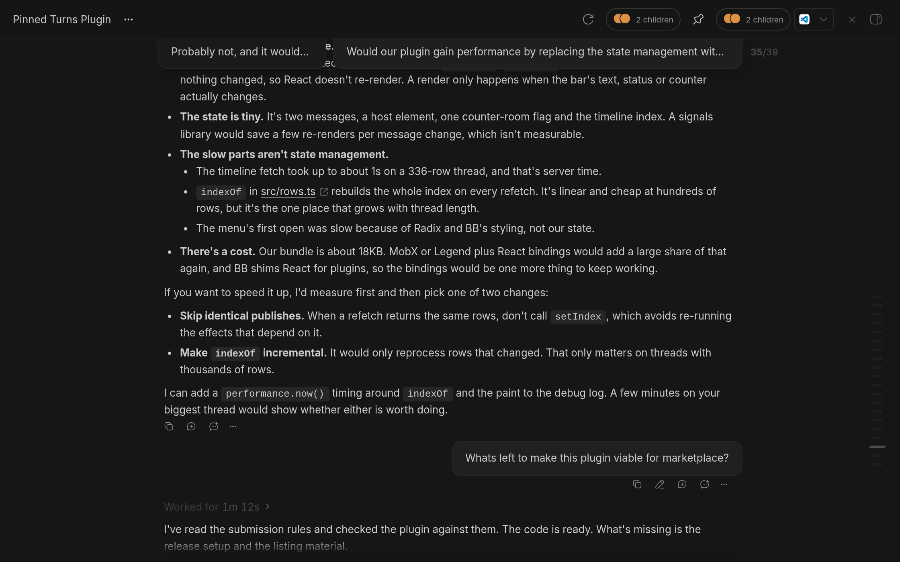
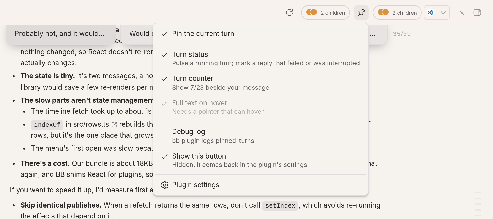
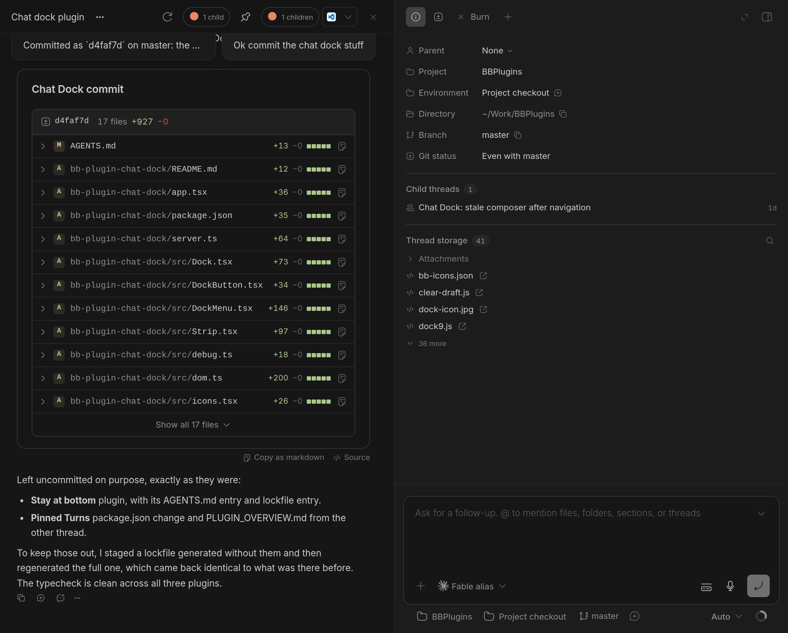
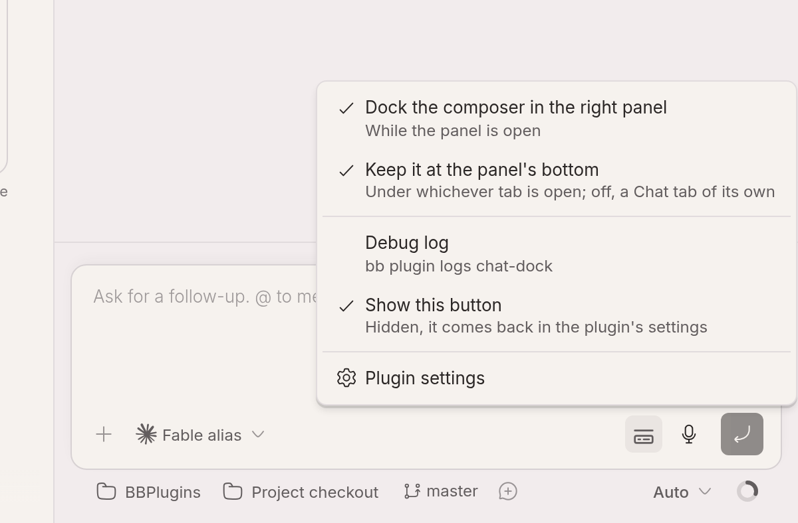
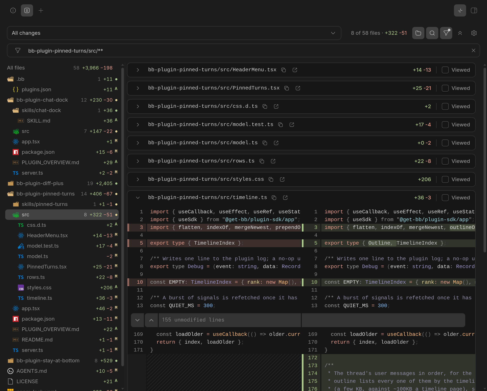

# BB plugins

Plugins for [BB](https://getbb.app), one folder each.

| Plugin | What it does |
| --- | --- |
| [Pinned Turns](bb-plugin-pinned-turns) | Keeps the message you are reading under and the latest agent reply pinned to the top of a thread; click either to jump to it. |
| [Chat Dock](bb-plugin-chat-dock) | Moves the composer into the thread's right panel while it is open, as a strip under any tab or as a Chat tab. |
| [Diff Plus](bb-plugin-diff-plus) | Adds a folder tree with per-folder counts and +/- to BB's Diff tab. |
| [Stay at bottom](bb-plugin-stay-at-bottom) | Keeps a streaming thread scrolled to its bottom when BB's own keeper slips. |

## Screenshots

**Pinned Turns**





**Chat Dock**





**Diff Plus**



## Install

From the BB plugin marketplace, or from this repository (each plugin is tagged `<id>/vX.Y.Z`):

```sh
bb plugin install git:https://github.com/nfour/bb-plugins.git@^0.1.0 --plugin pinned-turns --tag-prefix pinned-turns/
```

## Develop

A pnpm workspace. See [AGENTS.md](AGENTS.md) for how each plugin works and the BB page structure it relies on.

```sh
pnpm install
pnpm check                              # tsc in every plugin
pnpm build                              # bb plugin build in every plugin
bb plugin install ./bb-plugin-<id> --yes
bb plugin dev ./bb-plugin-<id>          # rebuild and reload on save
```

## License

MIT, except the vscode-icons glyphs in Diff Plus (CC BY-SA 4.0, see [its notices](bb-plugin-diff-plus/THIRD_PARTY_NOTICES.md)).
